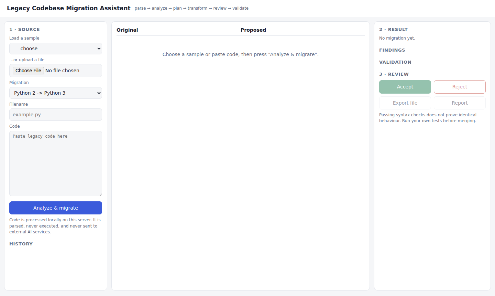
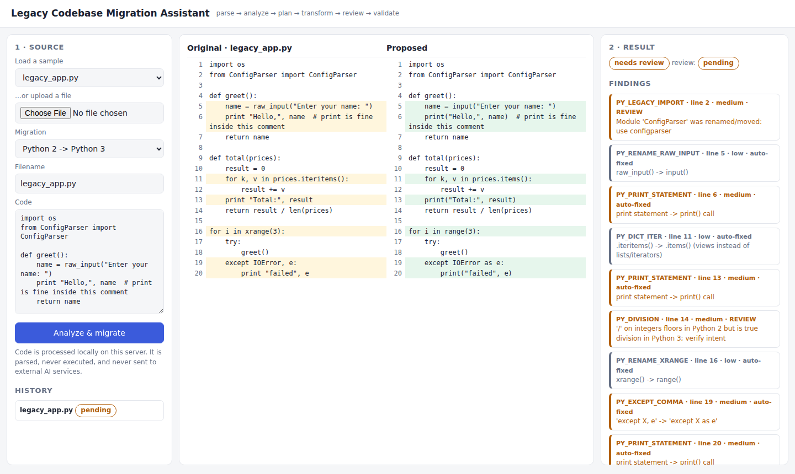
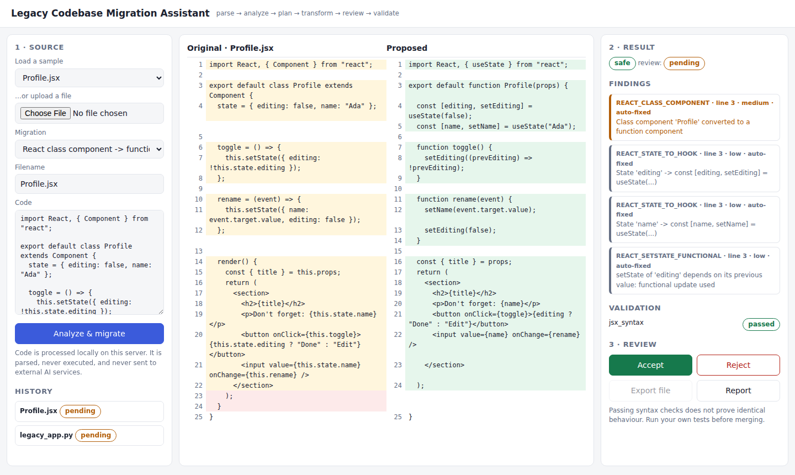
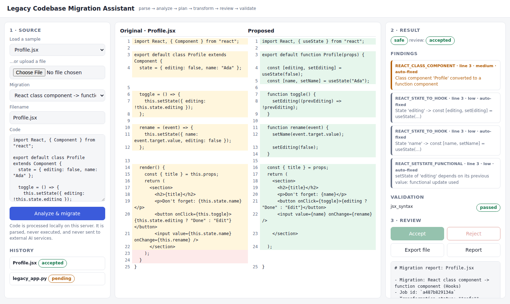
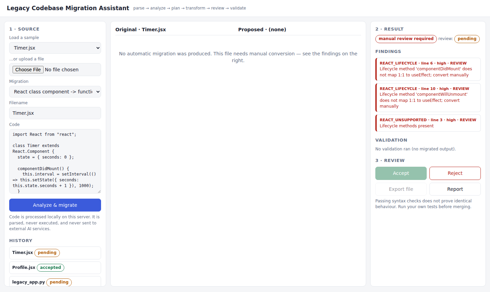

# Legacy Codebase Migration Assistant

A local web application for reviewing deterministic, syntax-aware migrations of legacy code. It proposes changes, displays a side-by-side diff, validates syntax, records migration history, and lets a developer accept or reject each result before export. Original source is preserved with SHA-256 hashes, findings, validation results, and a Markdown report.







## Supported migrations

- **Python 2 to Python 3** (`.py`): automatically applies a bounded set of syntax-aware rewrites, such as `print` statements to `print()`, `raw_input` to `input`, and `xrange` to `range`. Ambiguous or unsupported constructs are flagged for manual review.
- **React class components to function components with Hooks** (`.js`, `.jsx`, `.tsx`): converts a limited subset of class components. Lifecycle methods, complex constructors, and other unsupported patterns require manual review.

## Features

- Browser-based source input, sample projects, migration review, and job history.
- Side-by-side and unified diffs, findings, syntax validation, and downloadable reports.
- Accept or reject decisions before exporting migrated code.
- Secret-pattern detection that withholds matched values from findings and reports.
- Uploaded source is parsed, never executed; no external AI or network calls are made by the application.
- SQLite-backed migration history, configurable with `LMA_DB`.

## Requirements

- Python 3.10 or later.
- Node.js and npm for JSX syntax validation and the full test setup.
- Docker and Docker Compose for the containerized setup.

## Run locally

Install the backend dependencies and Babel parser, then start the server:

```bash
python -m pip install -r backend/requirements.txt
cd backend/tools
npm install
cd ../..
./scripts/run-server.sh
```

Open <http://127.0.0.1:8000>. The interactive API documentation is available at <http://127.0.0.1:8000/docs>.

To persist migration history locally, set `LMA_DB` to a SQLite file path before starting the server. Without it, the application uses an in-memory database.

## Run with Docker Compose

From the project root, build and start the app:

```bash
docker compose up --build
```

Open <http://127.0.0.1:8000>. Compose stores SQLite data in the `lma-data` named volume mounted at `/data` inside the container. The container is configured with a read-only root filesystem, a temporary filesystem at `/tmp`, and all Linux capabilities dropped.

## Run tests

```bash
./scripts/run-tests.sh
```

The test script installs the Babel parser if it is missing, then runs the Python test suite. Alternatively, run pytest directly after installing dependencies:

```bash
cd backend
python -m pytest -v
```

See [testing notes](docs/testing.md) for coverage details. Babel-dependent checks need `backend/tools/node_modules`.

## API overview

The service exposes these main routes:

| Method | Route | Purpose |
|---|---|---|
| `GET` | `/api/health` | Health status |
| `GET` | `/api/migration-types` | Available migration types |
| `GET` | `/api/samples` | Included sample source files |
| `POST` | `/api/migrations` | Create and run a migration |
| `GET` | `/api/migrations` | List migration jobs |
| `GET` | `/api/migrations/{id}` | Get a migration job |
| `GET` | `/api/migrations/{id}/findings` | Get migration findings |
| `GET` | `/api/migrations/{id}/diff` | Get side-by-side and unified diffs |
| `POST` | `/api/migrations/{id}/validate` | Re-run syntax validation |
| `GET` | `/api/migrations/{id}/tests` | Get validation results and notes |
| `POST` | `/api/migrations/{id}/review` | Accept or reject a migration |
| `GET` | `/api/migrations/{id}/export` | Export an accepted migration |
| `GET` | `/api/migrations/{id}/report` | Download or view the Markdown report |

The API accepts JSON for migration creation, for example:

```json
{
  "filename": "example.py",
  "content": "print 'hello'\n",
  "migration_type": "python2-to-python3"
}
```

## Project layout

```text
backend/app/              FastAPI API, migration rules, validation, storage, and security
backend/tests/            Unit, integration, and security tests
backend/tools/            Babel-based JavaScript and JSX syntax checker
frontend/index.html        Single-page review interface
sample-projects/           Inputs available in the UI and tests
scripts/                   Server, test, and screenshot utilities
docs/                      Architecture, security, testing, and migration details
```

## Security and limitations

This tool is designed for developer review, not unattended code conversion. Validation checks syntax; it does not prove behavioral equivalence or run the migrated project’s tests. Review every diff and run the target project’s test suite before merging.

Authentication and authorization are not implemented. Do not expose the service to untrusted users as-is. See [security notes](docs/security.md) and [architecture](docs/architecture.md) for further details.
